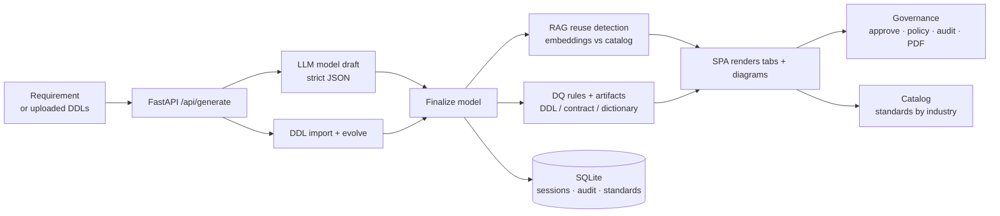

<div align="center">

# 🛠️ ModelIQ

### From a sentence to a governed, reusable data model — in minutes.

_An AI-assisted data-modeling & governance workspace for the enterprise._


-10A37F?logo=openai&logoColor=white)


</div>

---

## ✨ What it does

Describe a business requirement in plain English **— or upload existing SQL DDLs —** and ModelIQ produces a **governed, reuse-first logical data model**: entities and fields, enterprise-asset reuse detection, industry-standard mappings, design-review findings, data-quality rules, diagrams (ER / DFD / star), and deployable artifacts (DDL, data contract, dictionary, RBAC/tokenization SQL). A built-in **Governance** workflow handles approvals, policy checks, an audit trail, and a professional PDF export, while a **Catalog** manages the reference standards it aligns to.

> Nothing is faked — every entity, review comment, and reuse-match % comes from a real model call. The model is one input, not the product: the value is reuse detection, deterministic artifacts, standards alignment, and governance around it.

## 🌟 Highlights

- 🧠 **AI generation & evolve** — generate a fresh model, or upload DDLs and evolve them with a strict "change only what's asked" prompt (no unexpected renames or entities).
- 🔁 **Reuse detection (RAG)** — embedding cosine-similarity against a seeded enterprise catalog flags each entity as `REUSE` / `EXTEND` / `NEW` / `REVIEW`.
- 🏥 **Multi-industry** — Healthcare, Financial services, Education, Transport, E-commerce, Telecom, and general business, each with its own catalog & standards.
- 📐 **Live diagrams** — ER, Data-flow (DFD), Star/Snowflake, and Impact analysis rendered client-side as SVG.
- ✅ **Design review & data quality** — severity-tagged findings plus executable DQ rules (NOT NULL, referential integrity, uniqueness, access control).
- 📦 **Deployable artifacts** — dialect-aware DDL (LLM + validation, deterministic fallback), data contract (YAML), data dictionary (CSV), RBAC/tokenization SQL.
- 🛡️ **Governance** — model list, approvals, deterministic policy checks (PHI/PII, classification conflicts), an audit trail, and a formatted **PDF export**.
- 📚 **Standards catalog** — browse standards by industry and add your own (existing or new industry), fed straight back into the generate flow.
- 💾 **Persistent sessions** — chat history and models saved to SQLite; resume anytime.

## 🧭 How it works



## 🧱 Tech stack

| Layer | Choices |
| --- | --- |
| **Backend** | Python · FastAPI · Uvicorn |
| **AI** | Any OpenAI-compatible provider — free tiers like Google Gemini (chat + embeddings), Groq, or OpenRouter; Azure OpenAI also supported |
| **Auth** | API key via `OPENAI_API_KEY` (free tier); Azure AD token provider as an enterprise option |
| **RAG** | In-memory NumPy cosine similarity over a seeded per-industry catalog (no vector DB) |
| **Persistence** | SQLite (WAL) — sessions, chat, governance status, audit, custom standards |
| **Frontend** | Static HTML/CSS + vanilla JS, served same-origin (no build step, no CORS) |
| **Docs/Export** | Client-side print-to-PDF (no external libraries) |

## 📂 Repository layout

```
backend/
  app.py                FastAPI app: routes, _finalize_model, governance/catalog APIs
  prompts.py            System prompts, build_messages(), build_evolve_messages()
  llm_client.py         Shared LLM client (OpenAI-compatible or Azure), kwarg normalization
  auth.py               Azure AD token provider (enterprise option)
  ddl_import.py         Parse uploaded SQL DDL -> entities (Snowflake-aware)
  llm_ddl_generator.py  LLM DDL generation (per dialect)
  ddl_validator.py      Validates generated DDL against the model
  artifact_builder.py   Deterministic DDL / DQ SQL / contract / dictionary
  clinical_concepts.py  Concept inference + FHIR/OMOP standards mapping
  standards_library.py  Reference standards + descriptions per industry (Catalog)
  session_store.py      SQLite: sessions, messages, audit_event, custom_standard
  rag/
    catalog.py          Seeded enterprise metadata catalog (per industry)
    retriever.py        Embedding cosine-similarity best_match()
frontend/
  index.html            Workspace, tabs, Governance & Catalog views
  app.js                State, fetch wiring, rendering, SVG diagrams, PDF export
  styles.css            Base styling
  workbench.css         Workspace / governance / catalog styling
start.bat               One-click: venv + install + launch + open browser
docs/                   Supporting docs
```

## 🚀 Getting started

**Prerequisites:** Python 3.11+, and a `backend/.env` with an AI provider key — a free Google Gemini or Groq key works (see [Configuration](#️-configuration)).

**One-click (Windows):**
```bat
start.bat
```

**Manual:**
```powershell
# from the repo root
python -m venv .venv
.\.venv\Scripts\python.exe -m pip install -r backend\requirements.txt
cd backend
..\.venv\Scripts\python.exe -m uvicorn app:app --host 127.0.0.1 --port 5000
```

Then open **http://localhost:5000/** (not a `file://` path — the UI must be same-origin with the API).

> 💡 Run uvicorn from the `backend/` directory so `.env` is loaded; otherwise the gateway/embeddings won't initialize and reuse detection is skipped.

## 🔌 API surface

| Method | Route | Purpose |
| --- | --- | --- |
| `GET` | `/api/status` | LLM configured?, deployment, supported dialects |
| `POST` | `/api/generate` | Generate a model (`requirement`, `industry`, `standard`, `dialect`, optional `files[]` to import/evolve) |
| `POST` | `/api/refine` | Apply a follow-up change to a session's model |
| `GET` `PUT` `DELETE` | `/api/sessions[/…]` | List / open / rename / delete saved sessions |
| `GET` | `/api/governance/models` | Model list with stats & status |
| `POST` | `/api/governance/models/{id}/status` | Approve / needs-revision / draft |
| `GET` | `/api/governance/models/{id}/policy` | Deterministic policy findings |
| `GET` | `/api/governance/audit` | Audit trail (optionally per model) |
| `GET` `POST` `DELETE` | `/api/catalog/standards` | List / add / remove reference standards |

## ⚙️ Configuration

`backend/.env` (git-ignored — see `backend/.env.example`):

**Free tier (recommended) — any OpenAI-compatible provider:**

| Variable | Description |
| --- | --- |
| `OPENAI_BASE_URL` | Provider base URL (e.g. `https://generativelanguage.googleapis.com/v1beta/openai/` for Gemini) |
| `OPENAI_API_KEY` | Your free API key |
| `OPENAI_MODEL` | Chat model (e.g. `gemini-2.0-flash`) |
| `OPENAI_EMBEDDING_MODEL` | Embedding model (e.g. `text-embedding-004`) |

**Enterprise (optional) — Azure OpenAI (used only when `OPENAI_BASE_URL` is blank):**

| Variable | Description |
| --- | --- |
| `AZURE_OPENAI_ENDPOINT` | Azure/gateway base URL |
| `AZURE_OPENAI_DEPLOYMENT_NAME` | Chat deployment |
| `AZURE_OPENAI_EMBEDDING_DEPLOYMENT` | Embedding deployment |
| `CLIENT_ID` / `CLIENT_SECRET` / `TENANT_ID` | Azure AD auth (preferred) |
| `AZURE_OPENAI_API_KEY` | Static key fallback |

## 🔐 Security & privacy

- **Synthetic metadata only** — the app models entity/field *names and definitions*, never real records.
- PHI/PII is a **classification** that drives tokenized-view SQL and governance policy findings.
- LLM calls go through the **enterprise gateway** (not public OpenAI); the corporate root CA is trusted via `truststore`.
- All SQL is **parameterized**; model/user strings are **HTML-escaped** in the UI and PDF.
- Secrets (`.env`), the virtualenv, and the local SQLite DB are **git-ignored**.

## 🗺️ Roadmap

- Replace the seeded catalog with a live enterprise metadata source (Purview / Collibra / OpenMetadata) + a real vector store.
- SSO, role-based approvals, and shared audit persistence.
- Write approved models back to a registry; CI/CD to materialize DDL into Snowflake/Databricks.
- Automated tests for the deterministic layers (`artifact_builder`, `retriever`, `ddl_import`).

## 📝 Notes

- Reasoning-family chat deployments reject standard sampling params — route chat kwargs through `llm_client.normalize_chat_kwargs()`.
- The gateway requires `projectId` and `x-idp: azuread` headers (wired in `llm_client._default_headers()`).
- Diagrams infer relationships from PK/FK field-name conventions, so unusual naming can under-detect relationships.

<div align="center"><sub>Built for the hackathon · ModelIQ</sub></div>
